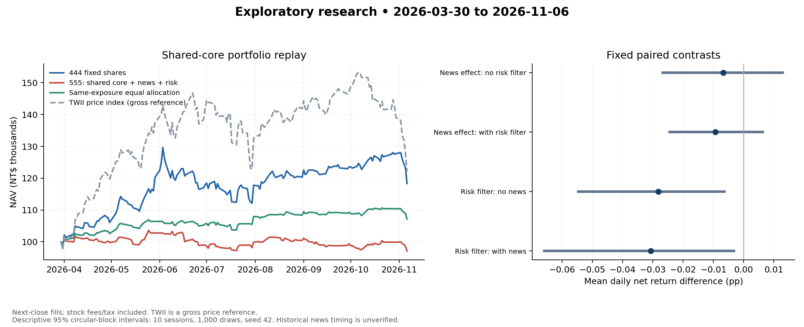

# 444／555 共同核心配對研究

資料截止：2026-11-06。本頁為主研究；原六特徵 555 的 Notebook 輸出另保留為延伸／歷史診斷。

全部配置組使用同一份 444 預測、次一交易日收盤、手續費 0.1425%、賣出稅 0.3%及共同期末處理。
歷史新聞未有完整取得證據，且期間已被查看；結果皆為探索性，不宣稱因果已驗證或前瞻績效。

| 組別 | 淨 ROI | Sharpe | MDD | 成本 |
| --- | ---: | ---: | ---: | ---: |
| static_equal444 | 18.32% | 1.405 | -13.50% | 668.20 |
| dynamic_no_news | 2.56% | 0.439 | -5.48% | 6584.94 |
| dynamic_news_no_risk | 1.44% | 0.256 | -6.38% | 10295.92 |
| dynamic_no_news_risk | -1.53% | -0.240 | -5.66% | 6382.74 |
| dynamic_news_risk555 | -2.93% | -0.455 | -6.29% | 8993.01 |
| equal_rebalanced_reference | 19.11% | 1.487 | -12.60% | 1280.00 |
| risk_matched_equal_reference | 7.12% | 1.404 | -3.16% | 5274.28 |
| market_price_reference | 22.09% | 1.238 | -20.31% | 0.00 |

同風控下新聞組與無新聞組的 ROI 差：-1.40 個百分點。這是配對策略差異，尚無統計顯著或歷史新聞因果認證。

444 固定持股的 ROI 不代表 LSTM 擇時獲利。模型的一日預測在次日收盤進場前已完成，其配置屬延遲訊號策略；首段漲跌未計入新部位收益。
^TWII 為無股利的理論價格參考；該列不扣交易成本，不視為可交易淨報酬。另列同交易機會及同政策總曝險等權組。

[逐日 NAV](nav.csv) · [成本與成交](fills.csv) · [權重](weights.csv) · [555 主研究當日配置](555_next_day_recommendation.csv)

[研究協議](protocol.json) · [永久輸入快照與程式雜湊](reproduction_manifest.json)

[固定配對效果與區塊重抽樣區間](analysis/contrasts.csv) · [按持有部位風險狀態分析](analysis/regime_effects.csv)

重播：`python -m scripts.paired_delivery --replay 本目錄/reproduction_manifest.json --output 新目錄`。重播讀取保存預測，不重新訓練。

